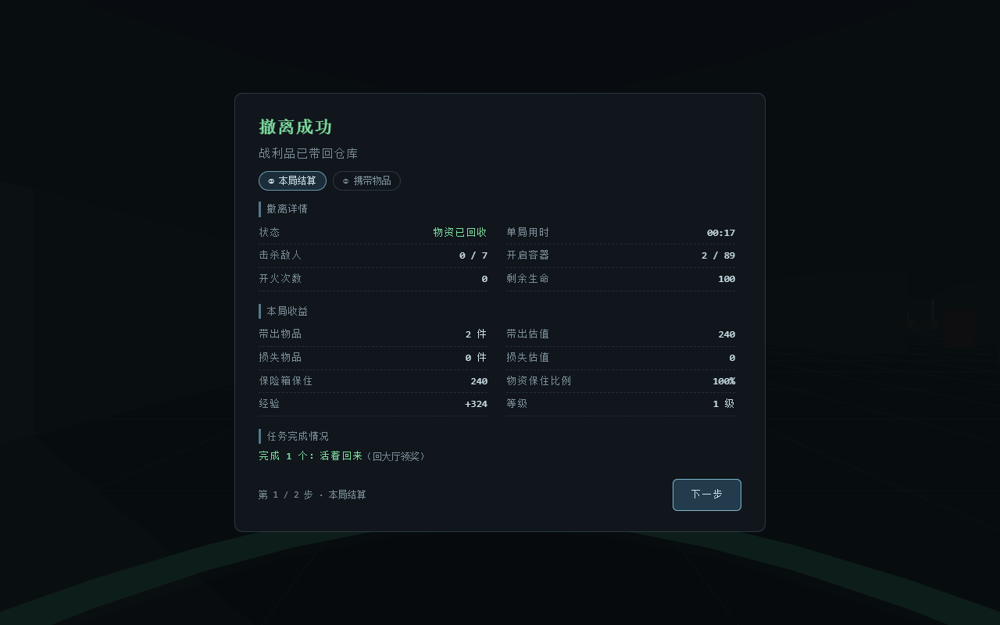
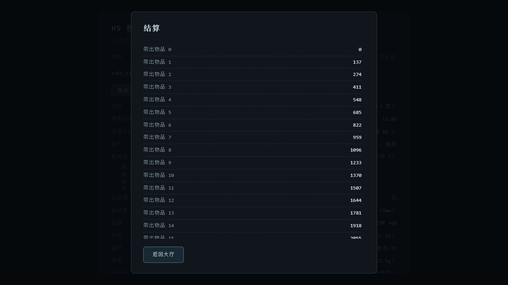

# M6 缺陷修复与界面调整记录

> 来源：制作人在**实际游玩**中报告的缺陷，以及随后提出的结算页改版要求。
> 记录口径沿用 M2 报告 §3：**现象 → 根因 → 为什么危险 → 修法 → 回归防护**。
> 每一条都必须留下"下次能被自动抓住"的断言，否则修完还会复发。

| 编号 | 现象 / 要求（玩家视角） | 根因 / 口径 | 状态 |
|---|---|---|---|
| M6-BUG-01 | 按 3 无法使用绷带（按了完全没反应） | 把绷带的 `maxHealthCap: 45` 当成了**使用门槛**，血量 ≥45 就一按无效 | 已修 |
| M6-BUG-02 | 按 4 使用急救包**读条异常** | 读条用**原始帧时间戳**，而计时用**局内时钟**（扣过暂停），本局暂停过就带偏移 | 已修 |
| M6-BUG-03 | 结算页面太长会超出屏幕，看不到"返回大厅" | 结算卡片没有 `max-height / overflow`，而 `body` 是 `overflow: hidden` | 已修 |
| M6-BUG-04 | 拖放"怎么拖都放不下"，提示却是**"这一格被别的物品占着"** | `packing.js` 的 `isAreaFree` 对非整数 / `NaN` 落点只回答 `false`，而 `stashMoveTo` 把它统一翻成 `occupied` —— 把"坐标非法"说成"被占用"，把排查引向错误方向 | 已修（见下方追加节） |
| M6-BUG-05 | 便携版测试报"空手""射击没反应"（12 / 14） | `tools/test-portable.mjs` 测的是 `release/` 里 **M5 时构建**的陈旧产物 —— 它一直在验旧代码 | 已修（见下方追加节，16 / 16） |
| M6-UI-01 | 结算页改为**分段式**（对齐《三角洲行动》） | 原为一长条：结论（撤离结果 / 收益 / 任务）会被埋在几十行物品清单里 | 已完成 |

---

## M6-BUG-01 按 3 无法使用绷带

**现象**：身上有绷带、按 3 完全没反应（无读条、无提示、道具不减少）。
按 4 用急救包却正常。—— 两条路径唯一的差别就是 `maxHealthCap`（绷带 45、急救包 100）。

**根因**：`vitals.canHealWith()` 把"该药能治到的上限"当成了**准入门槛**：

```js
const ceiling = Math.min(vitals.maxHealth, itemDef.maxHealthCap); // 绷带 = 45
return vitals.health < ceiling;                                  // 血量 ≥45 → 一律拒绝
```

于是绷带只在**血量低于 45** 时可用：满血 100 用不了、受伤到 60 也用不了。
急救包上限 100 = 血量上限，所以它几乎总是可用 —— 现象差异正好由这个数字解释。

**为什么危险**：这不是"平衡偏紧"，而是**道具在绝大多数时间里不可用**。
玩家从 100 血进场，只有被打到 45 以下才用得上绷带，而那正是最危险、最来不及包扎的时刻；
他唯一能得到的结论是"绷带坏了"。更糟的是**失败完全静默**：没绷带、满血、正在用别的药
三种情况给出同一个"毫无反应"，把玩家与开发者一起推向错误的归因。

> 历史注：M2 曾把"用绷带反而掉血"（`min(cap, health+amount)` 把 83 血钳到 45）登记为
> 严重缺陷，修法是**拒绝使用以免浪费**（docs/05-M2阶段报告.txt §3.4）。
> 那次修法本身没错，错在**把上限当门槛**——"不浪费"的正确判据是
> **"这次使用能否真的回血"**，而不是"血量是否低于某个数"。

**修法**（制作人裁定：绷带改为"未满血即可用"，恢复 18 点）：

1. `src/config/combat.json`：绷带 `maxHealthCap` 45 → **100**（= 该药能治到满血）。
   两件医疗品的区别回到它们该有的地方：**恢复量（18 / 65）与耗时（1400ms / 3000ms）**。
2. `src/gameplay/vitals.js`：`canHealWith()` 改为按**实际恢复量**判定 ——
   `min(ceiling, health + healAmount) > health`。它与 `heal()` 的落点用的是同一个式子，
   因此"能不能用"与"用了回多少"**不可能分叉**；同时 `healAmount` 缺失时会判为不可用（不浪费）。
3. `src/main.js`：消耗品判定收成一个 `tryUseConsumable()`，**每个拒绝分支都给出原因**
   （`没有绷带了` / `正在使用急救包，无法同时使用绷带` / `绷带此刻无法生效（生命已满或已到可治上限）`）。
   静默失败本身也是一条缺陷：它让"没生效"永远不可解释。

**回归防护**：
- 纯逻辑：`tools/unit-tests.mjs` — 用**真实配置**断言"60 血可用 / 99 血可用 / 满血被拒"，
  以及"60 血用绷带 → 78 血"。
- 端到端：`tools/smoke.mjs` 新增组 **`M6 医疗回归`**（可 `--only=医疗` 单独跑）：
  用 DEV 夹具把生命设为 60 → 按 3 → 断言**真的开始读条**且绷带 -1 → 回血到 78；
  另断言满血按 3 **不消耗**且**有文字原因**。
  （夹具 `window.__m2.setHealth(n)` 是为这一条新增的：`healPlayer` 只会加血，
  而本缺陷的现场恰恰是"未满血、但高于旧上限"这个血量区间。）

---

## M6-BUG-02 按 4 使用急救包的读条异常

**现象**：急救包读条不对 —— 一按下去进度条就不是空的（暂停过一局之后尤其明显），
暂停较久时**一按直接满格**。但**实际治疗时长是对的**（到点照样回血），
所以它是一条"看起来只是显示问题"的缺陷。

**根因**：同一件事用了**两只时钟**。

- 计时：`player.useConsumable(def, t)` 里的 `t` 是 `raidClock(nowMs)` —— 局内时钟，
  已经扣掉本局累计暂停时长（`pausedTotalMs`）。
- 显示：`raidView(nowMs)` 却把**原始帧时间戳**传给了 `player.useProgress(nowMs)`。

于是读条 = `1 - (useEndAt - nowMs) / useTotalMs`，其中偏移量恰好是
`pausedTotalMs / useTotalMs`。实测：本局暂停 2 秒后按 4（急救包 3000ms）→ 开场就是 **0.667**；
暂停超过 3 秒 → **直接 1.0（满格）**，直到真正结束才消失。

**为什么危险**：读条是玩家判断"我能不能撑住这次治疗"的唯一依据。
一个恒为满格或凭空领先的进度条，会让玩家在**还有 2 秒才回血**的时候以为已经治好了 ——
这类"时间感错位"在对枪中直接决定生死。它同时是一条**结构性**缺陷：
只要"局内还有第二只时钟"（暂停、后续可能的时间缩放），任何新增的进度条都会再犯一次。

**修法**：

1. `src/gameplay/vitals.js`：新增纯函数 `useProgressRatio(startedAt, totalMs, nowMs)` ——
   把时钟口径做成**可断言的一处**（并处理 `totalMs ≤ 0` / 非数值，任何输入都不产生 NaN）。
2. `src/gameplay/player.js`：记下 `useStartedAt`，`useProgress(nowMs)` 走上面这个纯函数；
   `cancelUse()` 一并清掉它。倍率被配置写坏（0 / NaN）时兜底回配置基线 ——
   **读条总时长必须是有限的、可解释的**。
3. `src/main.js`：`raidView()` 只算一次 `clock = raidClock(nowMs)`，
   计时、`flow.timing()`、读条**共用它**；视图新增 `useActive: player.isUsing()`。
4. `src/ui/hud.js`：读条**显隐看"是否正在使用"**，不再看"进度 > 0" ——
   起始那一帧进度恰好是 0，用进度判显隐会让进度条晚一帧才出现（同一缺陷的伴生现象）。

**回归防护**：
- 纯逻辑：`tools/unit-tests.mjs` — 起始 0 / 半程 0.5 / 到点 1、NaN 与负时长安全；
  以及**现场复现**：暂停 2 秒后，传原始时间戳得到 0.667（旧缺陷），传局内时钟得到 0（修复后）。
- 端到端：`tools/smoke.mjs` 的 `M6 医疗回归` 组断言"250ms 时绷带读条约 0.18、
  300ms 时急救包读条约 0.1"，并断言递增；
  `window.__m2.snapshot().player.useProgress` 是为可观测性新增的字段。

---

## M6-BUG-03 结算页过长会超出屏幕

**现象**：一局带出的东西多的时候，结算页被撑得比屏幕还高 —— 下半截（损失明细、
"存入仓库"、消耗统计）**根本看不到**，"返回大厅"按钮也被顶出屏幕，玩家只能刷新页面。

**根因**：结算卡片用的是基础 `.card`，**没有 `max-height` / `overflow`**；
而 `html, body { overflow: hidden }`。于是内容超出视口的部分既不滚动也不显示，
直接被裁掉。大厅卡片（`.card.lobby`）当初正是为此加了 `max-height: 92vh; overflow: auto`，
结算页被漏掉了 —— 而结算页的内容比大厅**更长**：带出 / 损失 / 存入仓库三份**逐件**清单，
外加稀有度、经验、等级、任务、消耗统计。

**为什么危险**：这是"出口消失"型缺陷。玩家看不到自己的损失清单（下次该不该贪的决策依据），
更严重的是**找不到离开结算页的按钮** —— 只能刷新页面，而刷新在这套设计里
意味着"这一局按断线处理"（见 M4-7 补结算）。一个纯 CSS 疏漏因此有了丢档的联想。

**修法**（`index.html`）：结算卡片加 `class="card end"`，做成**三段式**布局：
标题固定 / **明细区滚动** / 按钮固定。选择"只让明细区滚"而不是"整张卡片滚"，
是因为后者仍会把按钮滚出视野 —— 出口必须**永远**在屏幕内。

```css
.card.end { display: flex; flex-direction: column; max-height: 92vh; }
.card.end #endPages { flex: 0 1 auto; min-height: 0; overflow-y: auto;   /* M6-UI-01 前叫 #endBody */
  overscroll-behavior: contain; padding-right: 8px; scrollbar-width: thin; }
.card.end .end-foot { flex: none; }                                       /* 按钮组常驻屏幕内 */
```

**回归防护**：`tools/smoke.mjs` 的结算页组里，实时注入 **80 行**明细复现"很长的一局"，
再量三件事：卡片上下边都在视口内、**"返回大厅"按钮底边 ≤ 视口高度**、
明细区自身可滚动（`overflow-y: auto` 且 `scrollHeight > clientHeight`）。
只断言 CSS 里写了 `max-height` 是证明不了"按钮真的在屏幕内"的。

---

## M6-UI-01 结算页改为分段式

**要求**（制作人）：结算页改成类似《三角洲行动》的分段式 ——
第 1 段只显示**撤离详情 / 本局收益 / 任务完成情况**；点右下角「下一步」进入
**撤离携带物品的详情**；第 2 段右下角「返回大厅」回到大厅。

**为什么必须分段（而不是继续加滚动）**：这与 M6-BUG-03 是同一个病根的两面。
内容量随战利品条数**无上限增长**，单页只能靠滚动，而玩家最需要先看到的三件事
（撤离结果、收益、任务）会被埋进几十行物品里 —— 上一版就是这样：一局带出 40 件时，
开场看到的是物品清单的**中段**（见 `results/end-screen-long-before.png`）。
分段后：**结论在一屏内讲完**，清单是"想看才点进去"的第二屏。

**结构**（`index.html` + `src/ui/hud.js`）：

| 部分 | 内容 | 归属 |
|---|---|---|
| 卡头 | 结果标题（撤离成功 / 阵亡 / …）+ 副标题 + 步骤指示（① 本局结算 / ② 携带物品） | 固定，不滚动 |
| 第 1 段 | 撤离详情（状态 / 用时 / 击杀 / 容器 / 开火 / 剩余生命）· 本局收益（带出·损失·保险箱·保住比例·经验·等级·消耗）· 任务完成情况 | `#endPage1` |
| 第 2 段 | 带出的物品（含稀有度汇总）· 损失的物品 · 入库明细（存入仓库 / **仓库已满未能存入**） | `#endPage2` |
| 底部 | 左：「第 N / 2 步」；右（右下角）：第 1 段「下一步」，第 2 段「上一步 / 返回大厅」 | 固定，不滚动 |




**实现上的几个刻意选择**（都被断言或代码注释钉住）：

1. **一次画完两段，切换只改显示**：结算数据是纯函数产物、本局不会再变。
   若"点下一步时再渲染"，就存在"两段看到不同数据"的可能。
2. **按钮显隐写在 CSS**：`.card.end[data-step="1"] #btnRestart { display: none }`。
   界面状态只有一个来源（`data-step`），不逐元素改 `style`。
3. **第 1 段用两列统计网格**（`.grid2`）：单列时 800px 高的窗口要滚一下，
   而这一滚恰好会把「任务完成情况」推进盲区 —— 那正是分段要解决的问题。
   实测第 1 段 `scrollHeight === clientHeight`（**完全不需要滚动**）。
4. **换段把 `scrollTop` 归零**：两段共用一个滚动容器，否则第 1 段滚到底后切过去，
   第 2 段会"从中间开始"，玩家会以为物品清单是残缺的。
5. **id → 人话**：核心层只给 id（`questsCompleted` 是 id 数组、`questsAdvanced` 是
   `{questId, objectiveId, from, to, need}`、入库明细只有 `itemId`）。
   `createHud(cfg)` 现在读 `cfg.quests` 与 `cfg.itemDefs`，把任务显示成
   「活着回来 —— 成功撤离 1/1」、把入库显示成「5.56 弹药 ×60」，
   而不是 `q1_first_extract` / `ammo_556`。这份映射不另建表，直接用配置的真值。
6. **已完成的任务不再出现在"推进"里**：它的目标必然也被记为"推进了一项"，
   两条都列就是同一件事说两遍（截图里就是"完成 1 个：活着回来"这一行）。
7. **「下一步 / 上一步」是纯界面状态，留在 hud.js**；**「返回大厅」是流程动作**，
   仍由 `main.js` 接线（`hud.el.btnRestart`）—— 界面状态与游戏流程不混在一起。
   多给了一个「上一步」：两段式里没有它，玩家想再核对一次收益就只能重打一局。

**回归防护**（`tools/smoke.mjs`，全量跑时覆盖）：

- M5-1 组：第 1 段**只有**「下一步」可见、第 2 段与「返回大厅」都还不存在；
  点「下一步」→ 第 2 段出现且右下角换成「返回大厅」；点「上一步」回到第 1 段；
  再点「下一步」→「返回大厅」→ 真的回到大厅（且**全程没有刷新页面**）。
  这条路径必须走真实按钮：旧断言直接点 `#btnRestart`，在新结构下那个按钮在第 1 段是隐藏的
  —— 而"按钮藏起来了测试还点得到"本身也不该被允许。
- 结算页组：第 1 段的段标题必须恰好是「撤离详情 / 本局收益 / 任务完成情况」，
  三段各自有关键行（用时·击杀·容器·开火·生命 / 带出估值·保险箱·保住比例·经验 / 有任务文案），
  且**逐件清单不在第 1 段**（`#endPage1` 里不得出现「带出的物品（」）。
- ⑧b 的"超长不溢出"断言改为**切到第 2 段**再撑满 80 行来量（明细现在在第 2 段）。

---

## 验证与证据

| 项 | 命令 | 结果 |
|---|---|---|
| 纯逻辑单测 | `node tools/unit-tests.mjs` | **492 / 492 通过** |
| 端到端（只跑医疗回归） | `node tools/smoke.mjs --only=医疗` | **12 / 12 通过** |
| 端到端（只跑结算页组） | `node tools/smoke.mjs --only=结算页` | **37 / 37 通过** |
| 端到端（全量） | `node tools/smoke.mjs` | **254 / 254 通过**（exit 0） |
| 首包体积门禁 | `node tools/measure-bundle.mjs` | brotli **186.7 KB** / 上限 200 KB（余量 13.3 KB） |
| 生产构建不含调试接口 | `node tools/verify-prod-bundle.mjs` | 通过（`setHealth` 等 DEV 夹具均未进入产物） |
| 便携版重建 | `node tools/build-portable.mjs` | `release/H5-SDC-PVE-M5/game.html` 794.7 KB（自包含） |

### 现场数字（可直接复核）

**M6-BUG-01 / M6-BUG-02**（`--only=医疗` 与全量冒烟均复现同一组数）：

```
· 夹具：本局累计暂停约 1523ms   ← 旧实现在这个偏移下读条会直接满格（1523/1400 > 1）
[PASS] 夹具成立：生命被设为 60（高于绷带旧上限 45、也不是满血）      —— health=60
[PASS] 60 血按 3 能用绷带（回归：按 3 无法使用绷带）                —— using=true 绷带 4 → 3
[PASS] 绷带读条与已过时间成正比                                   —— progress=0.1769（250/1400≈0.18）
[PASS] 绷带回血 18 点（60 → 78）                                  —— health=78
[PASS] 急救包读条与已过时间成正比                                  —— progress=0.0998（300/3000≈0.10）
[PASS] 满血时按 3 被拒绝且不消耗绷带                               —— 绷带 3 → 3, using=false
[PASS] 拒绝使用时给出了原因                    —— toast="绷带此刻无法生效（生命已满或已到可治上限）"
```

**M6-BUG-03**（全量冒烟里实时注入 80 行明细后量出来的几何）：

```
视口 1280×720：
  修复后（.card.end）   cardTop=29  cardBottom=691  btnBottom=664  vh=720  可滚动=true
  修复前（无 .card.end） cardTop=-994 cardBottom=1714 btnBottom=1687 vh=720  可滚动=false
```

对照截图（用**生产产物**便携版跑出来的，小屏 720p 更容易暴露问题）：

- 修复前： —— 标题与按钮都被顶出屏幕，`body` 是
  `overflow:hidden`，玩家只能看到战利品清单的**中段**，且无法滚动。
- 修复后： —— 标题固定在顶部、明细区滚动、
  「返回大厅」固定在屏幕内。


## 本次改动文件清单

| 文件 | 改动 |
|---|---|
| `src/config/combat.json` | 绷带 `maxHealthCap` 45 → 100 |
| `src/gameplay/vitals.js` | `canHealWith` 改为按实际恢复量判定；新增纯函数 `useProgressRatio` |
| `src/gameplay/player.js` | 记 `useStartedAt`；`useProgress` 走纯函数；倍率兜底 |
| `src/ui/hud.js` | 读条显隐改看 `useActive`；宽度做 [0,1] 钳位；**结算页改为两段式**（一次画完两段 + `showResultStep` 切换 + 任务/物品 id→名称映射 + 已完成任务去重） |
| `src/main.js` | 消耗品判定收成 `tryUseConsumable`（拒绝也给出原因）；`raidView` 统一用局内时钟；新增 DEV 夹具 `setHealth` 与可观测字段 `useProgress`；`createHud(cfg)` |
| `index.html` | `.card.end` 三段式布局（明细滚动、按钮固定）；**两段结构 + 步骤指示 + 右下角按钮组 + 两列统计网格** |
| `README.md` | 医疗规则口径（未满血即可用 / 满血拒绝）；结算界面描述改为两段式 |
| `docs/05-M2阶段报告.txt` | 在旧的绷带结论处加"※ 后记（M6 修正）"指向本次修复 |
| `tools/unit-tests.mjs` | 绷带语义 / 读条时钟口径的纯逻辑断言 |
| `tools/smoke.mjs` | 新增 `M6 医疗回归` 组；结算页超长实测（改为量第 2 段）；**两段式导航断言**；结算页三段内容断言；历史组里已过时的绷带断言修正；`--only` 时 M5 组自带页面加载 |
| `results/end-step1.png` `results/end-step2.png` | 两段式结算页的实测截图（真实一局：撤离成功 + 任务完成） |

---

## 追加：M6-BUG-04 / M6-BUG-05（M6-3 界面批次发现并修复）

> 这两条与上面三条不是同一批工作，但同属 M6，因此登记在同一份清单里，便于"下次能被自动抓住"。
> 完整上下文见 [`docs/20-M6-3-配装与仓库合并报告.md`](20-M6-3-配装与仓库合并报告.md) §6.1。

### M6-BUG-04 非法坐标被说成"这一格被别的物品占着"

**现象**：拖放"怎么拖都放不下"，而提示是"这一格被别的物品占着" —— 玩家与开发者都会被引到
"空间不够"这个错误方向（**实现者本人被它带偏了一整轮**）。

**根因**：`packing.js` 的 `isAreaFree` 对非整数 / `NaN` 落点只回答 `false`（它本来只管"空不空"），
而 `stashMoveTo` 把 `false` 统一翻译成 `occupied`。于是"抓取偏移算成 `NaN`"（例如拖动源漏带 `x/y`）
表现为"目标格被占用"。**两种完全不同的失败共用一个原因串**。

**修法**：在唯一入口 `dropItem()` 处显式区分 —— 落点不是整数格就返回 `bad-target`，
文案「落点不是一格（坐标非法）」。单测带**注入自检**（半格坐标 + `NaN` 各一例），确保这条
诊断不会再退化。

### M6-BUG-05 便携版测试一直在验 M5 的陈旧产物

**现象**：重建产物后 `tools/test-portable.mjs` 从"通过"变成 `12 / 14`，失败项是
"射击使弹匣减少"（`弹匣 0 / 0`）与"HUD 显示武器"（显示"空手"）—— **看起来像射击坏了**。

**根因**：该测试测的是 `release/` 目录里**已存在**的 `game.html`，而那份是 M5 时构建的、
之后从未重建。**它验的不是当前代码**，因此"便携版通过"这句话一直没有意义。
M6 起"局内只装仓库真的拿得出来的东西"，而新账号仓库为空（制作人裁定）→ 不买装备直接进战区
就是空手，重建后那两条必然失败。

**修法**：改走玩家唯一的真实路径 —— 新账号先在商店买 P9 + 一盒 9mm（起始预设里本来就写着
`secondary = pistol_p9` + 9mm 60 发），并新增一条"买入真的扣钱"的**状态**断言
（货币 20000 → 18515）。现在 **16 / 16**。

**教训**：这类缺陷比"功能坏了"更隐蔽 —— 功能没坏，是**检查本身过期了**。
它的通用形态是"测试依赖某个已存在的产物/缓存，而那个产物不会自动跟着代码走"。

